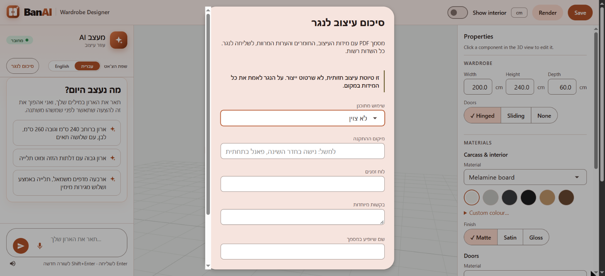

# Features built in this fork

Features built in [itaybs/banai](https://github.com/itaybs/banai) and proposed to [JonathanZouari/banai](https://github.com/JonathanZouari/banai) as pull requests to `dev`, newest first. Each page covers what the feature does and why, its PR and status, its commits, key decisions, known issues, and screenshots.

Status as of 2026-10-29. All five PRs are open and not reviewed yet.

| | Feature | PR |
|---|---|---|
|  | **[A room around the wardrobe](room-scene/README.md)**: view the wardrobe inside a room, with furniture, light, camera views and where the doors open. Decoration only; needs a proposed CLAUDE.md exception. | [#94](https://github.com/JonathanZouari/banai/pull/94) · open, no conflicts |
|  | **[Template gallery with real 3D thumbnails](start-templates/README.md)**: three new starting templates next to the basic wardrobe, with real 3D thumbnails and an inside view. | [#86](https://github.com/JonathanZouari/banai/pull/86) · open, conflicts with `dev` |
|  | **[What will change, in the proposal card](proposal-diff/README.md)**: the AI proposal lists the exact changes, computed from the design, and highlights each part in 3D. | [#70](https://github.com/JonathanZouari/banai/pull/70) · open, conflicts with `dev` |
|  | **[Design summary card](design-summary/README.md)**: counts, gross interior volume and hanging length at the top of the Properties panel. | [#53](https://github.com/JonathanZouari/banai/pull/53) · open, conflicts with `dev` |
|  | **[Agent review: fixes from 30 UI tests and a language selector](agent-review/README.md)**: 30 behaviour tests went from 23/4/3 to 30/0/0 pass/partial/fail; an explicit reply language replaces detection. | [#18](https://github.com/JonathanZouari/banai/pull/18) · open, conflicts with `dev` |

## Earlier work

Two branches that were never submitted as their own PRs. **Both are not submitted and superseded by upstream's own feature.**

**Voice-agent test round** ([`feature/voice-agent`](https://github.com/itaybs/banai/tree/feature/voice-agent), 13 commits). *Not submitted, superseded by upstream's own feature.* This is where the [agent review](agent-review/README.md) started. It ran 30 behaviour tests of the AI designer and voice through the real UI in Chrome, and fixed what they found. Its 9 code commits were later resubmitted as PR #18 (`pr/agent-review`). The other 4 commits are the test report, in Hebrew, with its re-test rounds: [`reports/voice-agent-test-report.html`](https://github.com/itaybs/banai/blob/feature/voice-agent/reports/voice-agent-test-report.html). Upstream has since built its own voice and language handling (including Spanish), which overlaps this work. It has no screenshot, because it has no screen of its own beyond #18's.

**Summary PDF for the carpenter** ([`pr/spec-pdf`](https://github.com/itaybs/banai/tree/pr/spec-pdf), 12 commits: #18's 9 plus 3 of its own). *Not submitted, superseded by upstream's own feature.*
- **Backend:** `POST /api/spec/pdf` turned the confirmed design into a visual design draft for the carpenter, explicitly not a manufacturing file. It used fpdf2 with right-to-left Hebrew, a disclaimer on every page, and nothing stored. Every number came from the design, and the model wrote only an optional summary checked by the production-claim guard.
- **Frontend:** a "Summary for the carpenter" dialog with optional answers (intended use, location, timeline, requests) and a straight front capture from the 3D view. The PDF went to the share sheet on touch devices, or was downloaded on desktop.

It waited for #18 to be merged first. Meanwhile upstream shipped its own carpenter PDF ("Generate Style Profile", `POST /api/export/pdf`, with reportlab).

*The "Summary for the carpenter" (סיכום לנגר) dialog on `pr/spec-pdf`, at 100% browser zoom: the disclaimer first, then the optional fields. Its button sits beside the chat's language selector.*
