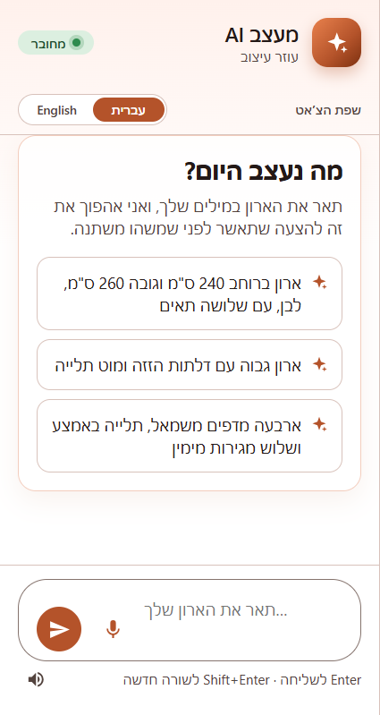
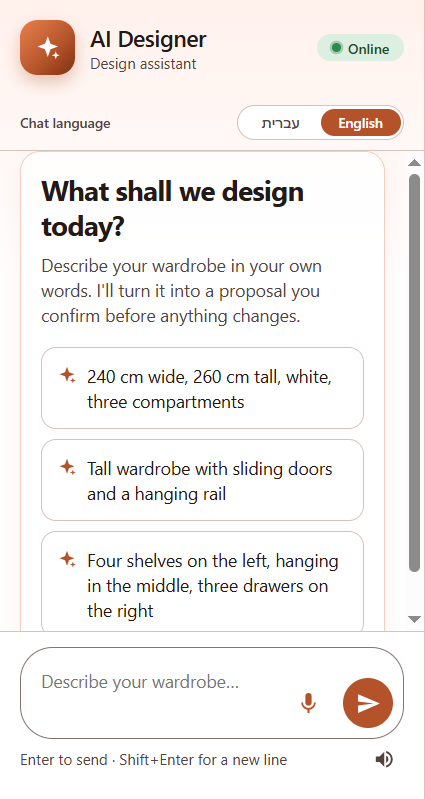
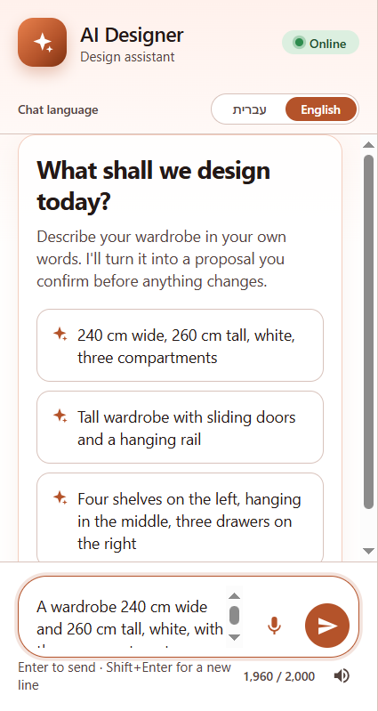

# Agent review: fixes from 30 UI tests and a language selector

**PR:** [JonathanZouari/banai#18](https://github.com/JonathanZouari/banai/pull/18), `Agent review: fixes from 30 UI tests, a language selector, and code-side checks`
**Status (2026-10-29):** open against `dev`, not reviewed yet. **It has merge conflicts with the current `dev`** in 9 files. Upstream has since reworked language handling (`backend/app/agent/language.py` keeps detection and adds a chosen language), so the selector needs to be reconciled with it.
**Branch:** [`pr/agent-review`](https://github.com/itaybs/banai/tree/pr/agent-review), 9 commits on top of `dev` at `a93762a`.

## What it does and why

I tested the AI designer with **30 behaviour tests sent through the real UI in Chrome**, then fixed what they found. On those 30 tests, the results went from **23 pass / 4 partial / 3 fail to 30 / 0 / 0**.

The biggest change, flagged in the PR for the maintainer's decision, is **a language selector instead of automatic language detection**:

- **Before:** the reply language was detected from the latest message, and writing in the other language switched the whole chat.
- **Now:** an **עברית / English selector above the chat** (Hebrew by default, remembered per browser). The selected language is the **only** reply language, even when the customer writes or speaks in another one. `/api/chat` requires `language` (`he` or `en`), and transcription uses it as the language hint.
- **Why:** customers mix languages: a Hebrew sentence with an English brand name, or an English word in a voice message. Detection then flipped the chat back and forth. An explicit choice makes the reply language predictable.

The other fixes:

**Agent (backend)**
- Emoji joined with a zero-width joiner (👨‍👩‍👧) are allowed in messages; they used to get a 422.
- `[app] applied: …` and `[app] cancelled: …` notes go into the history, so the agent knows what was confirmed. The prompt says the current design is the source of truth.
- A narrow production-claim check runs on the agent's output ("ready for production", "manufacturable", "מוכן לייצור", …) through the existing repair loop.
- A proposal with more change rows than ops goes back for repair.
- **Clearance warnings are written by code, not the model:** under 90 cm below a rail, under 20 cm between shelves, and under 150 cm for long items. The model used to ignore the computed numbers.
- **A number without a unit always means cm.** A proposal that reads "200" as 200 mm goes back for repair.
- **Safer failures:** speech fails fast (20 s, no retry). Agent and voice failures log only the error class, status and code, never the message, because provider messages can include parts of the key. Quota and account problems return a separate `503 AGENT_ACCOUNT` message.
- **Prompt rules:** offer concrete options for vague requests, state the allowed range for out-of-range values, describe proposals as proposals rather than done facts, use gender-neutral Hebrew, and ask a short question when a bare number is unclear.

**Chat (frontend)**
- A message refused with a 4xx is left out of later history (it used to break every following request), with a friendly note instead of the HTTP text.
- A character counter near the 2,000-character limit, and a warning when a paste is cut.
- **Read-aloud starts off on every visit.** A saved "on" used to keep it on after one stray click; it's no longer persisted.

The model (`gpt-5.4-mini`) is unchanged, and there are no infrastructure, Railway or Supabase changes.

## Screenshots

*The language selector above the chat, with Hebrew (the default) selected. The whole chat is right to left.*

*With English selected, the chat and its suggestions switch to English. Replies come only in the selected language, whatever language the customer writes in.*

*A character counter appears near the 2,000-character limit.*

These were taken from the `pr/agent-review` branch at 100% browser zoom. No chat messages were sent.

## Commits

| Commit | |
|---|---|
| `aa17f7d` | feat(agent): system prompt rules from the agent review |
| `32f95a0` | fix(agent): emoji messages, production-claim guard, safer failures |
| `0b9bc4d` | fix(chat): refused messages, applied/cancelled notes, length warnings |
| `22ce6c9` | fix(agent): computed rail/shelf clearances, change rows <= ops, safe voice logs |
| `122b902` | feat(chat): language selector; the selected language is the only reply language |
| `f3452f3` | feat(agent): clearance warnings written by code, not the model |
| `87accf1` | fix(chat): read-aloud starts off on every visit |
| `1b39945` | fix(agent): gender-neutral Hebrew clarification questions |
| `9043d0d` | fix(agent): a number without a unit always means centimetres |

## Key decisions

- **An explicit language over detection,** because mixed-language messages made detection flip. The PR offers a middle way if the maintainer prefers: keep detection as the default and make the selector an override.
- **Code, not the model, for anything numeric or safety-related:** clearance warnings, the unit rule, change rows vs. ops, and production claims. The model kept ignoring computed numbers.
- **Never log provider messages:** only the error class, status and code.
- **Changed E2E tests** (listed in the PR): the auto-switch test in `agent.spec.js` is replaced by "the selected language is the only reply language, whatever is written". Two `voice.spec.js` tests now expect the selected language.

## Security review

`/security-review` of the diff (input validation including model output, secrets, authorization, injection, data exposure): **no findings.**

- The relaxed message pattern adds only U+200D; bidi overrides and control characters are still rejected.
- `[app]` notes and `language` can't bypass the signed proposal, the revision and hash checks, or the speech signature.
- All new DOM text uses `textContent`.
- DoS limits are unchanged (2,000-character messages, a 30-message history), and the new regexes are linear.
- `npm audit`: 0 vulnerabilities, with no dependency changes.

## Testing

- **On the branch:** pytest 282/282, vitest 199/199.
- **Playwright** (`agent.spec.js` + `voice.spec.js`, `--workers=1`, on a low-memory Windows machine): 4 passed, including the new selected-language test.
  - *"switching to English localizes the chat…"* timed out once under load, then passed alone.
  - *"switching language never changes what is already on screen"* and *"speaking sends the transcript…"* also fail on untouched `dev` on that machine (slowness and the fake microphone). So the edited assertions in that voice test couldn't be verified locally.
  - The rest of the E2E suite wasn't run locally.

## Known issues and limitations

- **Merge conflicts with the current `dev` in 9 files** (see Status). Upstream's later language work (detection plus a chosen language, and Spanish) overlaps the selector, so this needs a real reconciliation, not a mechanical rebase.
- **The selector offers he/en only.** Upstream has since added Spanish.
- **A broken link in the PR description:** the full test report is linked at `itaybs/banai/blob/main/reports/voice-agent-test-report.html`, but that file exists only on the [`feature/voice-agent`](https://github.com/itaybs/banai/blob/feature/voice-agent/reports/voice-agent-test-report.html) branch.
- A follow-up feature (the carpenter summary PDF on `pr/spec-pdf`) was built on top of this PR and never submitted. Upstream has since shipped its own carpenter PDF (see [Earlier work](../README.md#earlier-work)).
