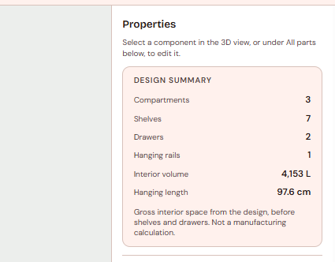

# Design summary card

**PR:** [JonathanZouari/banai#53](https://github.com/JonathanZouari/banai/pull/53), `feat(editor): design summary card`
**Status (2026-10-29):** open against `dev`, not reviewed yet. **It has a merge conflict with the current `dev`** in `frontend/src/editor/panel.js`.
**Branch:** [`feature/design-summary-panel`](https://github.com/itaybs/banai/tree/feature/design-summary-panel), 5 commits on top of `dev` at `5ffbe83`.

## What it does and why

A read-only **Design summary** card at the top of the Properties panel gives the customer the totals of their design at a glance. It comes from the student features list ("פאנל סיכום עיצוב").

| Row | How it's calculated |
|---|---|
| Compartments, Shelves, Drawers, Hanging rails | Counts across the whole design |
| Interior volume (L) | **Gross:** the sum, per compartment, of inner width × interior height (height − 2 × panel thickness) × full depth. The model has no back panel (the 6 mm back in the 3D view is visual only), and shelves and drawers aren't subtracted. Shown in whole litres. |
| Hanging length (cm) | The sum of compartment inner width × the number of rails in it, so **each rail counts**: double hanging counts the width twice. Shown in cm with one decimal, like the rest of the panel. |

- The card reads only the committed design, never the agent's text. Manual edits, confirmed AI proposals and designs opened from a saved link all update it. A pending proposal doesn't.
- The footnote says the volume is gross and "Not a manufacturing calculation". There are no prices.

## Screenshots

*The Design summary card at the top of the Properties panel, with the footnote that the volume is gross and not a manufacturing calculation.*

## Commits

| Commit | |
|---|---|
| `0192152` | feat(domain): designSummary pure function for the summary card |
| `9c28190` | feat(editor): design summary card with polite live updates |
| `c1eea69` | test(e2e): design summary card updates and saved-link load |
| `f8cf62a` | style(editor): design summary card in one column |
| `a223e47` | test(e2e): reopen the saved link in the same tab in the summary spec |

## Key decisions

- **A pure function,** `designSummary(design)` in `frontend/src/domain/geometry.js`. It's frontend-only and not an op, so there's no backend mirror and no parity fixture.
- **Gross volume, stated plainly:** shelves and drawers aren't subtracted, and the footnote says so, so the number can't be read as a manufacturing figure.
- **Each rail counts** toward the hanging length, so double hanging counts twice.
- **The card is created once and stays mounted** while the panel sections re-render, so its live region persists. The panel's existing focus-restore behaviour is unchanged.
- The card is English and left to right, like the rest of the Properties panel.

## Accessibility

- A `<section>` labelled by its heading, with a `<dl>` (one `dt`/`dd` pair per value).
- A separate, visually hidden `role="status"` (polite) announces **only the values that changed**, for example "Design summary: Hanging rails 2, Hanging length 128.6 cm." Bursts of edits are debounced into one message. Nothing is announced on first load or on selection changes.

## Testing

- **Unit (vitest):** 24 new tests: 6 for `designSummary` and 18 for formatting and announcements (rounding: 0.4 L → 0, 0.5 L → 1, 999.5 L → 1,000; zeros; only changed rows announced). The full suite passed: 234 tests.
- **Playwright:** the new `summary.spec.js` passed (4 tests: load with no announcement, manual add and remove, an AI proposal pending vs. confirmed, a design reopened from a saved link).
- **Chrome walkthrough** against the real backend: a manual change, an AI change after Confirm (one real chat call), a saved link reopened, and a depth change. No console errors.

## Known issues and limitations

- **Merge conflict with the current `dev`** (see Status). It needs a rebase.
- **Two axe tests time out** in `a11y.spec.js` at 30 s on a 4-core machine with software 3D rendering. One also times out on unchanged `dev`. With a 2-minute limit, both pass with no WCAG 2.1 AA violations. `test.slow()` for the axe tests may be worth considering.
- **No undo yet.** The card follows the store, so it will update after a future undo automatically.
- The card isn't translated (English, like the whole Properties panel).
