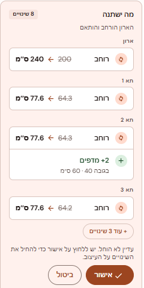
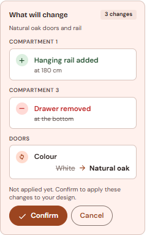
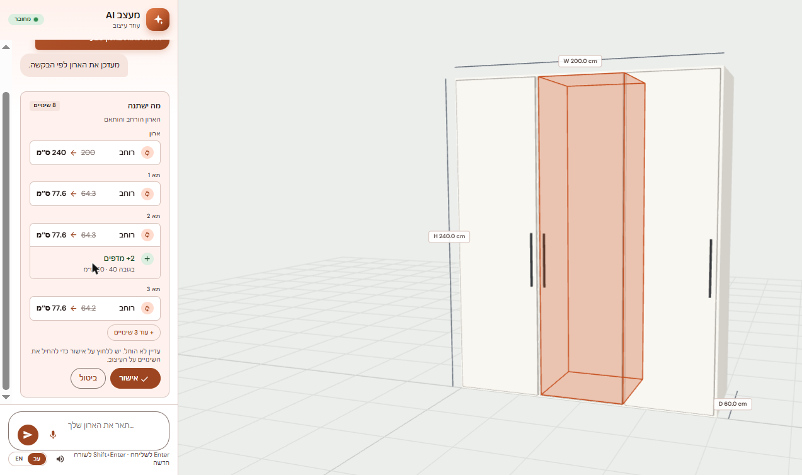

# What will change, in the proposal card

**PR:** [JonathanZouari/banai#70](https://github.com/JonathanZouari/banai/pull/70), `feat(chat): show what will change in the proposal card`
**Status (2026-10-29):** open against `dev`, not reviewed yet. **It has a merge conflict with the current `dev`** in `frontend/src/viewer/viewer.js` (upstream's camera focus touched the same file).
**Branch:** [`feature/proposal-diff`](https://github.com/itaybs/banai/tree/feature/proposal-diff), 6 commits on top of `dev` at `a8599e1`.

## What it does and why

Before **Confirm**, the AI's proposal card lists exactly what will change: "Width 200 → 240 cm", "+2 shelves", "Drawer removed".

**Why:** the customer should confirm what will actually happen, not the model's description of it. A real example from testing: for a height change from 240 to 250 cm, the agent wrote "Reduce height" / "I'll lower the wardrobe". The computed row correctly said "Height changes from 240 cm to 250 cm".

- The list is computed by comparing the current design with **`applyOps` on a copy**, replaying the proposal's signed ops. It never comes from the agent's text.
- The agent's one-line summary stays above the list as context.
- Rows are grouped by **Wardrobe**, **Compartment N** and **Doors**. N is the same left-to-right number the editor shows.
- Long lists show 5 rows and a "+ N more changes" toggle.
- **Hovering or focusing a row tints the affected part in 3D**, with an outline that's visible even behind closed doors.
- The committed design doesn't change until Confirm.

Covered changes:
- dimensions;
- compartments added, removed or resized;
- shelves, drawers and rails added, removed or moved, including parts that move to another compartment when a partition is removed;
- shelf thickness and drawer height;
- material, colour and finish on the body, the doors and per-item overrides;
- door type, count and hinge side;
- `create_wardrobe`, shown as one "new layout" row;
- several ops at once.

## Screenshots

*The card in Hebrew (right to left). The arrow mirrors, and signed counts stay "+2".*

*The card in English, with the change list grouped by part.*

*Hovering "+2 מדפים" (+2 shelves) tints compartment 2 in the 3D view, in the app's accent colour.*

## Commits

| Commit | |
|---|---|
| `c502fe9` | feat(domain): proposalChanges diff between a design and its proposed ops |
| `6796315` | feat(chat): he/en wording for proposal changes, with screen-reader sentences |
| `b8a4feb` | feat(chat): "What will change" in the proposal card, computed from the design |
| `ff994a1` | docs(frontend): what will change in the proposal card |
| `2d25706` | feat(viewer): highlight the parts of a change row in 3D on hover or focus |
| `d3ea8bc` | test(e2e): group labels include the folded Doors group; "+ N more" keeps focus |

## Key decisions

- **Computed, never trusted from the model:** the diff replays the signed ops on a copy of the design.
- **Fallbacks:** if the diff can't be computed (no ops to replay, or the engine refuses them), the card shows the agent's own rows. A stale proposal (the design changed after it was made) shows no list at all, and the existing stale message and disabled Confirm are unchanged. So the card never shows an outdated diff.
- **The 3D highlight is a separate preview layer** (`viewer.preview(ids)`). It never writes to the store, the selection or the doors toggle. Confirm, Cancel, a new card or a new design clear it. It's the last, separate commit, so it can be dropped without touching the card.
- **Small changes in shared files:** PR #54 also touches `chatPanel.js` and `i18n.js`, so this PR adds only one `diff` option and three strings there. New code is in its own files: `domain/diff.js`, `chat/proposalDiff.js`, `chat/changeList.js`, `chat/diffText.js`, `chat/diffStrings.js`, `styles/proposalDiff.css`.
- **Numbers drop a trailing ".0"** in the card ("200", "64.3"). The app's global `cm()` is unchanged.
- **Hebrew catalog names** mirror `CATALOG_NAMES["he"]` in the backend. A unit test fails if a catalog id has no Hebrew name. Customer-facing Hebrew is gender-neutral, and verbs agree with the part.

## Accessibility

- Semantic nested lists: each group's label names its list.
- Each row has a full sentence for screen readers ("Width changes from 200 cm to 240 cm"). The visual arrows and struck-through values are `aria-hidden`.
- Not colour alone: +, − and ↻ badges and the text carry the meaning. The colours pass WCAG AA on the card.
- Rows that preview a part are focusable with a visible focus ring. "+ N more" is a button with `aria-expanded`.
- In Hebrew the arrow mirrors and values are bidi-isolated.
- The row entrance is off under `prefers-reduced-motion`. At 280 px wide there's no horizontal scroll.
- **axe-core: 0 violations** with the card open in English and Hebrew.

## Testing

- **Frontend unit tests:** 241 passed, 31 of them new (the diff, the screen-reader sentences in he/en, and the read-only link to the store).
- **Backend:** 244 passed; no backend changes.
- **Chrome walkthrough with the live agent** (3 chat calls): grouping, "+ 2 more" expanding in place, keyboard focus with the 3D tint, Cancel clearing the tint, Confirm as the only step that changes the design, and the stale case.
- **Playwright** wasn't run locally (low memory). Re-reading the specs against the app found and fixed one bug in an assertion.

## Known issues and limitations

- **Merge conflict with the current `dev`** (see Status). It needs a rebase onto upstream's camera focus.
- Upstream added Spanish after this branch was made, so the change rows exist in he/en only.
- Out of scope, noted in the PR:
  - The existing stale message is masculine Hebrew ("בקש מהמעצב הצעה חדשה").
  - The agent's summary line sometimes uses the past tense before Confirm ("The wardrobe was widened…").
- The voice flow (microphone) wasn't exercised by hand.
