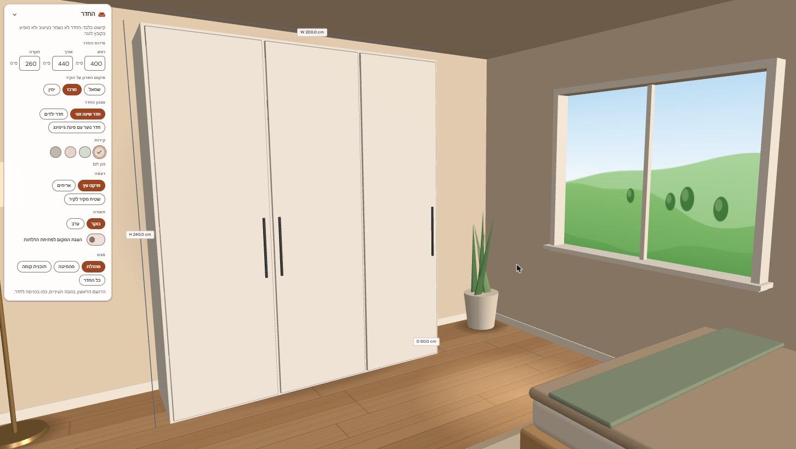
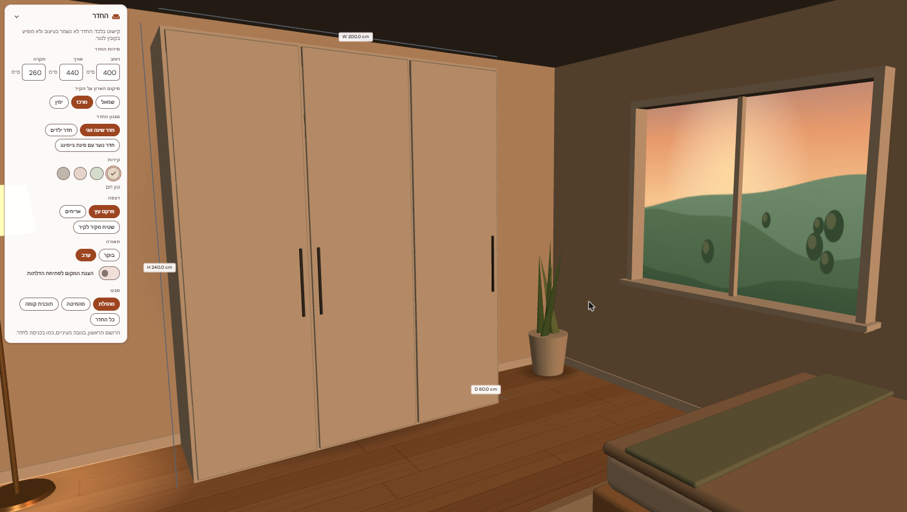
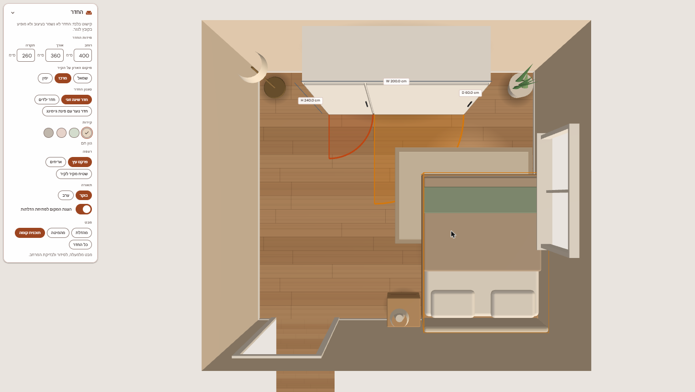
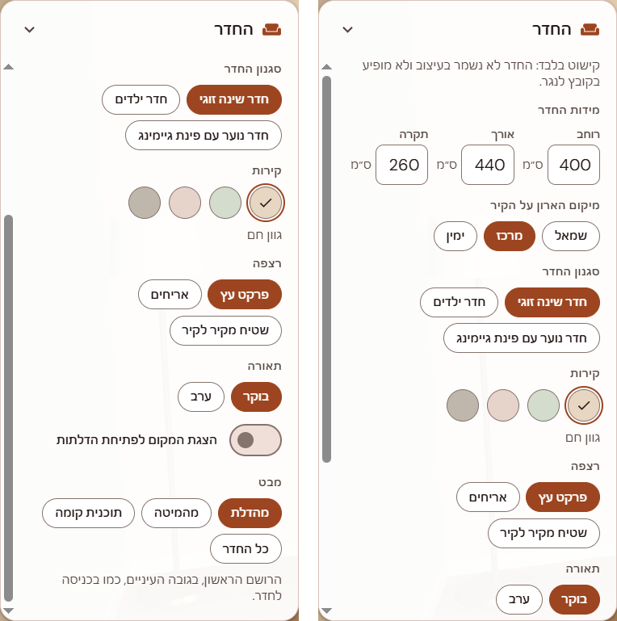

# A room around the wardrobe

**PR:** [JonathanZouari/banai#94](https://github.com/JonathanZouari/banai/pull/94), `feat(viewer): an immersive room around the wardrobe`
**Status (2026-10-29):** open against `dev`, no merge conflicts, not reviewed yet. **It needs an exception to CLAUDE.md** (room design is excluded). The exception is proposed in its own commit and marked *pending Jonathan's approval*.
**Branch:** [`feature/room-scene`](https://github.com/itaybs/banai/tree/feature/room-scene), 11 commits on top of `dev` at `076547d`.

## What it does and why

A wardrobe is hard to judge floating on a grey grid. **View in a room** places it inside an enclosed room in the 3D viewer, so the customer can see how it looks against a wall, next to a bed, from the doorway, in morning or evening light.

The room is **decoration only**:

- It lives in its own `roomState`, remembered per browser (`localStorage` key `banai.room.v1`). It never enters the design store.
- It's never saved with the design, never sent to the server or the AI, and never shown in the carpenter PDF or the template thumbnails. `tests/unit/room/exclusion.test.js` pins all of this.
- The wardrobe is untouched. It keeps its size and coordinates, and the room is built around it.
- The room is **off by default**. Turning it off brings the viewer back exactly as before.

The **Room** panel sets:

- **Room size** (width, length, height), shown in the chosen display unit (cm, mm or in) and stored as integer mm. The room never shrinks below the wardrobe; a note says when a size was raised to fit.
- **Wardrobe position** on the back wall: left, centre or right.
- **Room style:** couple's bedroom, kids' room, or teen room with a gaming corner. Each comes with procedural furniture (no image files) placed clear of the wardrobe, the doorway and the window.
- **Wall colour** (4 swatches), **floor** (wood, tiles, carpet) and **light**: morning sun through the window, or evening with lamps glowing.
- **Door swing:** a switch that draws on the floor where the wardrobe's hinged doors open.
- **Camera views:** from the doorway, from the bed, floor plan, and the whole room, with a natural lens. The wardrobe always stays in frame, and the panel (or the narrow-screen bottom sheet) never hides it.

## Screenshots



*From the doorway, in the morning: the first view after turning the room on. The Room panel (Hebrew) is on the left, and the camera frames only the area beside it.*



*The same view in the evening: a low, warm sun in the window, dim sky light and the lamps glowing.*



*Floor plan with the door swing on: a 2000 mm wardrobe with two hinged doors in a 4000 × 3600 mm room. The wide right door's swing reaches the bed, so the bed is outlined in amber. There's no text, warning or rule.*



*The Room panel in Hebrew (right to left, sizes in cm), at 100% browser zoom. It scrolls in a short window, so it's shown in two parts: the top on the right, and the rest after scrolling on the left.*

## Commits

| Commit | |
|---|---|
| `e4c856e` | feat(room): an enclosed room around the wardrobe, off by default |
| `d889c89` | feat(room): furniture and room styles, placed clear of the wardrobe |
| `03b4b94` | feat(room): camera views with a natural lens, the wardrobe always in view |
| `17620d7` | feat(room): morning and evening light, wall colours and floors |
| `f755a2a` | feat(room): where the doors open, drawn on the floor |
| `f4d8761` | docs(claude): propose the room exception (pending Jonathan's approval) |
| `411b9b8` | fix(room): bottom-sheet panel for a narrow 3D view, framed above it |
| `6917767` | feat(room): Spanish room strings, English for anything missing |
| `917bb4b` | feat(room): room sizes in the chosen display unit (cm, mm, in) |
| `acc622a` | fix(room): show the room hint only after the onboarding tour |
| `8e2d35e` | fix(room): eye-level views orbit around the wardrobe |

## Key decisions

- **Its own state, not the design.** The room has its own store, so nothing about it can reach a saved design, the AI, the PDF or the thumbnails. This is what keeps it decoration and not "room design".
- **The room is built around the wardrobe.** The wardrobe keeps the viewer's coordinates: x from its outer left face, y up from the floor, its front at z = 0. Walls, the doorway and the window are placed relative to it.
- **Builds on upstream's features** that were merged while this was in progress:
  - **Camera flight** (`viewer/cameraFocus.js`): room views use the same 400 ms ease-out flight, extended so a pose may also carry a field of view that eases with it. Compartment focus is unchanged (same timing, and the lens is never touched), and two new tests pin that. Selecting a compartment with the room on simply focuses it.
  - **Onboarding tour:** the one-time "View in a room" hint waits until the tour closes or is skipped. The tour itself is unchanged.
  - **Spanish:** room strings in he, en and es. Any missing string falls back to English.
  - **Display units:** room sizes use `formatLength` and `parseLength`, and values stay in mm.
- **The placement solver** keeps the doorway clear, keeps furniture out of the window zone, tucks chairs under desks, and checks sightlines from the doorway to the wardrobe's front.
- **Views use a natural lens:** 42° to start, 58° at most (50° with the window in view). Framing is checked by exact projection.
- **Single-sided walls with a cutaway:** walls the camera is outside of are hidden every frame, and so are the ceiling and the window view when seen from outside or above.
- **The palette is checked:** every wall colour differs from every catalog colour by a WCAG contrast or a CIE ΔE of at least 10, so the wardrobe stands out against its wall.
- **Door swing is visual only.** The swing is an exact convex shape. Furniture that intersects it turns amber, with no text, warning or rule, so this is not a feasibility rule. The placement solver already avoids swings, so amber shows up mostly in tight rooms. It becomes most useful once furniture can be moved by hand (PR B).

## Performance

Measured in Chrome (synchronous renders, 1280 × 800):

| | Draw calls | Frame time |
|---|---|---|
| Room off | 27 | 0.6 ms |
| Room on (all styles, both lights) | 64–78 | 2.6–3.8 ms |

Draw calls came out at **64–78 rather than the planned 35–40**, but **every frame stays under 4 ms**. Textures are small canvases, built once and disposed with the room. The per-frame work is the wall cutaway check.

## Accessibility, as implemented

- **View in a room** is a toggle button with `aria-pressed`. The Room panel is a `<section>` labelled by its heading, and it collapses with a button that has `aria-expanded` and `aria-controls`.
- Every control is a native button, text input or checkbox, so it works by keyboard with the app's focus ring. Choices are button groups (`role="group"` with a label) whose options use `aria-pressed`. Wall swatches have names (`aria-label` and `title`), not just colours.
- Size fields are text inputs with `inputmode="decimal"` and `aria-describedby` pointing at the unit and the message. Invalid input sets `aria-invalid` and shows a `role="alert"` message ("Enter a number.").
- When the room is raised to fit the wardrobe, or furniture doesn't fit, a `role="status"` note says so.
- Keyboard focus stays on the same control when the panel redraws. **Show me** in the hint moves focus into the panel. *Closing the panel doesn't move focus back to the button.*
- Views and transitions respect `prefers-reduced-motion`: they jump instead of flying.
- Hebrew is right to left.
- **axe-core: 0 violations** with the panel open in Hebrew, in English, and in Spanish with inches.

## Testing

- **Unit tests:** `tests/unit/room/` (exclusion, furniture, layout, look, placement, roomState, strings, swing, units, views), plus the camera-flight tests in `tests/unit/viewer/cameraFocus.test.js`.
- **Suites on the branch:** frontend 326 passed, 2 failed; backend 281 passed, 1 failed. All three failures already exist on `dev` (see below).
- **Chrome walkthrough:**
  - every view and transition;
  - focusing a compartment with the room on;
  - on a first visit, the tour followed by the hint;
  - the panel in he, en and es, and in inches;
  - the narrow-screen bottom sheet;
  - no console errors.
- **Playwright** wasn't run locally because the machine is low on memory, and the repo has no CI.

## Known issues and limitations

### Tests that already fail on upstream `dev` (`076547d`)

These three fail the same way on a clean checkout of `dev` at `076547d`. They aren't caused by this PR: upstream added Spanish without these texts.

| Test | Why it fails |
|---|---|
| `frontend/tests/unit/chat/i18n.test.js` › chat strings › *every language defines exactly the same keys* | Spanish (`STRINGS.es` in `frontend/src/chat/i18n.js`) has no `tour` block: 12 keys are missing (listed below). |
| `frontend/tests/unit/ui/tour.test.js` › tour steps and texts › *has every tour text in every chat language* | The same 12 Spanish `tour` keys. |
| `backend/tests/agent/test_spanish.py::test_every_language_table_has_spanish` | `CATALOG_NAMES["es"]` in `backend/app/export/strings.py` has no names for `olive_green`, `solid_oak` and `terracotta`. |

The 12 Spanish keys missing on `dev` (every room key exists in he, en and es):

```
tour.replay
tour.progress
tour.next
tour.back
tour.skip
tour.done
tour.steps.chat.title
tour.steps.chat.body
tour.steps.editor.title
tour.steps.editor.body
tour.steps.viewer.title
tour.steps.viewer.body
```

### Other limitations

- **Needs the CLAUDE.md exception.** If it isn't approved, the PR should be closed.
- **Furniture is placed automatically.** Moving it by hand is PR B, and it needs its own exception because drag-and-drop is excluded too.
- **Draw calls** are about twice the plan (see Performance), though frame times are well within budget.
- **Playwright** wasn't run (see Testing).

## What's next

**PR B: moving furniture by hand.** Drag-and-drop, with a keyboard alternative, behind its own proposed exception. That's where the door-swing view becomes most useful.
