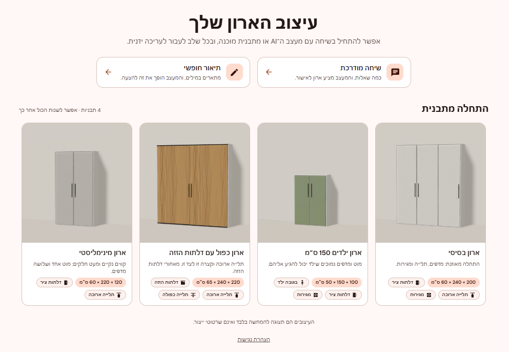
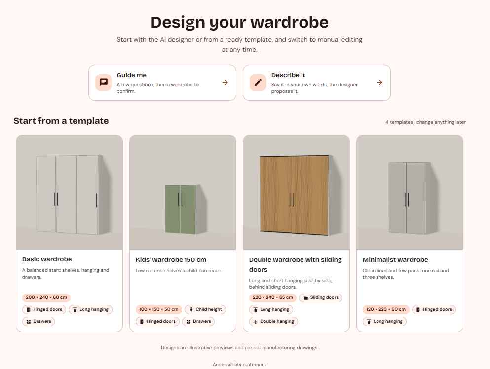
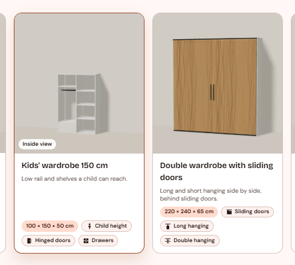
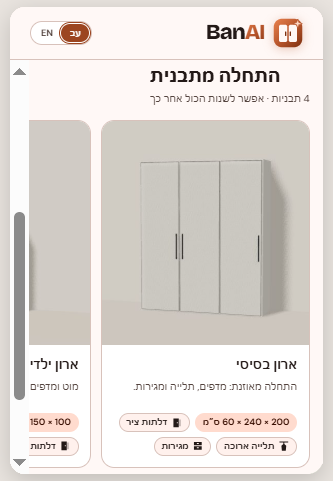

# Template gallery with real 3D thumbnails

**PR:** [JonathanZouari/banai#86](https://github.com/JonathanZouari/banai/pull/86), `feat(entry): template gallery with real 3D thumbnails`
**Status (2026-10-29):** open against `dev`, not reviewed yet. **It has merge conflicts with the current `dev`** in `frontend/src/chat/i18n.js` and `frontend/src/viewer/snapshot.js`, after 8 later upstream merges.
**Branch:** [`feature/start-templates`](https://github.com/itaybs/banai/tree/feature/start-templates), 7 commits on top of `dev` at `a8599e1`.

## What it does and why

The start screen offered one ready-made design, the basic wardrobe. This feature adds three more, so a customer can start closer to what they want. All four are shown in a **gallery of cards with real 3D thumbnails**.

| Template | Size (W × H × D) | Inside |
|---|---|---|
| Basic wardrobe | 200 × 240 × 60 cm | Unchanged (`BASIC_WARDROBE_OPS`) |
| Kids' wardrobe 150 cm | 100 × 150 × 50 cm | Bottom drawer, rail and shelves, all within a child's reach. Hinged sage-green doors. |
| Double with sliding doors | 220 × 240 × 65 cm | Long hanging on one side, double short hanging on the other. Two sliding oak doors. |
| Minimalist | 120 × 220 × 60 cm | One long-hanging rail and three well-spaced shelves. Light-grey satin doors. |

- **Real thumbnails** come from the app's own engine (`renderSnapshot`), not illustrations. All are drawn at **one shared scale**, so the 150 cm kids' wardrobe really looks smaller than a 240 cm one.
- **An inside view on hover or focus:** the same wardrobe rendered without doors cross-fades in, showing the rails, shelves and drawers.
- **The chosen card's thumbnail morphs** into the 3D editor (View Transitions).
- **Card text is measured from each design, so it can't overclaim:** the feature chips, the size chip and the screen-reader description.

## Screenshots

*The start screen in Hebrew, the new default: the two AI entry points as compact cards, then the template gallery.*

*The same screen in English. The size chips and feature chips are measured from each design.*

*Hover or keyboard focus: the same wardrobe without doors cross-fades in to show the inside.*

*At 375 px the gallery becomes a scroll-snap carousel with the next card peeking in.*

## Commits

| Commit | |
|---|---|
| `61ebcca` | feat(domain): kids, double sliding and minimalist starting templates |
| `ce4179c` | feat(viewer): opt-in thumbnail mode for renderSnapshot |
| `489ece5` | feat(entry): template card text measured from the designs, he/en |
| `2d82a43` | feat(entry): template gallery on the start screen with real 3D thumbnails |
| `3b3401b` | docs(frontend): start-screen template gallery and thumbnails |
| `0932d08` | fix(entry): the page behind the start screen never scrolls |
| `29f215d` | feat(entry): the chosen template's thumbnail morphs into the 3D view |

## Key decisions

- **Templates are lists of ops,** like `BASIC_WARDROBE_OPS`: `TEMPLATE_OPS` and `buildTemplate()` in `frontend/src/domain/presets.js`. They're mirrored in `backend/app/domain/defaults.py` (`TEMPLATE_OPS`, `build_template`).
- **Golden fixtures keep the two sides equal.** The backend generated `shared/fixtures/designs/template_*.json`. Both vitest and pytest build exactly those designs, and `validateDesign` passes, so the two op lists can't drift.
- Choosing a template other than basic replaces the design through its ops (revision + 1). Basic still opens the server's default design.
- **An opt-in thumbnail mode:** `renderSnapshot(design, catalog, { thumbnail: true })` uses 512 px shadows, no environment map and the shared framing. Measured with software WebGL, that's 150–570 ms per picture instead of 630–785 ms. **The carpenter PDF's render is unchanged,** and a test pins its settings and camera.
- **Gentle on weak devices:** thumbnails render one at a time, only while the browser is idle (front views first, then inside views), and are cached in `localStorage`, so later visits are instant.
- **A drawn fallback:** an SVG front view drawn from the design is the placeholder while rendering. It's also the fallback when WebGL is missing or a render takes over 2.5 s; rendering then stops.
- **Ergonomics are checked in tests only,** as documented prototype assumptions: hanger room above every rail; free hanging length (90 cm for adults, 70 cm for kids); at least 25 cm between parts; in the kids' template, every rail and shelf at most 120 cm from the floor. Nothing is shown to users as a rule, because CLAUDE.md excludes feasibility rules.
- The templates are configurable prototype layouts, not business data, and nothing claims they can be manufactured.

## Behaviour changes (flagged in the PR for review)

- **The start screen opens in Hebrew by default** and has its own he/en switch, sharing the chat's language setting. Before, it was English only.
- **The basic wardrobe is the first card in the gallery** instead of one of three entry cards. It keeps `data-testid="entry-basic"` and opens the same design.

## Accessibility

- **One Tab stop for the gallery** (roving focus). The arrow keys follow the reading direction (mirrored in Hebrew), plus Home and End; Enter or Space chooses.
- Each card's name is the template name. Its description is the story line, the features, and alt text generated from the design.
- **Never colour alone:** every chip has an icon and text. The focus ring is a visible 3 px outline.
- **`prefers-reduced-motion`:** no lift, zoom, fade, shimmer or morph.
- **axe-core (WCAG 2.1 A/AA): 0 violations** on the start screen in Hebrew and in English.

## Testing

- **Backend:** 254 passed, 10 of them new (every template validates and equals its golden).
- **Frontend:** 244 passed, 33 of them new: parity with the goldens, ergonomics, chips and screen-reader text, the thumbnail queue, and the unchanged PDF render.
- **Chrome walkthrough:**
  - each template opens its design;
  - thumbnails and inside views render;
  - hover, keyboard and the morph work;
  - at 375 px only the carousel scrolls;
  - with WebGL blocked, the drawn views stay;
  - a chat proposal on the kids' template was confirmed and applied.
- **Playwright** wasn't run locally (low memory). `ux.spec.js` was updated and re-read against the app.

## Known issues and limitations

- **Merge conflicts with the current `dev`** (see Status). It needs a rebase before it can be merged.
- Upstream added Spanish after this branch was made, so the template card texts exist in he/en only.
- **The morph is the last, separate commit** and can be dropped on its own. Without the View Transitions API the start screen fades out instead.
- Playwright wasn't run locally.
